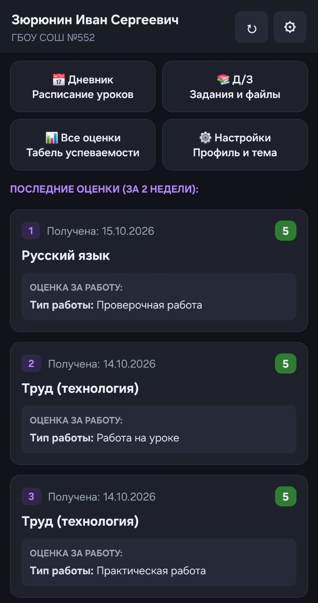

<div align="center">

# 🎓 Dnevnik SPb (No-Gradle Edition)

**An ultra-lightweight, 100% open-source, zero-bloat Android client for Saint Petersburg schools (`dnevnik2.petersburgedu.ru`).**

[](https://github.com/ibcsz12/SPBplus-dnevnik/releases)
[](https://t.me/nixwaretop)
[](#)
[](#)
[](https://github.com/ibcsz12/SPBplus-dnevnik?tab=MIT-1-ov-file)

<br/>

<!-- SCREENSHOT PREVIEW -->


<br/>

*Designed specifically for Saint Petersburg ("Петербургское образование") students and parents.*

*Compiles in 2 seconds directly via standard Android CLI build-tools without Gradle or heavy third-party frameworks.*

</div>

---

## ⚡ Why This Project?

The official web portal and legacy mobile apps are notoriously bloated, slow, and often crash during peak morning hours. This client was engineered from the ground up to solve these issues:

- **Zero-Gradle Architecture:** Pure native Android SDK (`android.*`). Zero external bloated Maven dependencies. The entire APK builds in ~2 seconds and weighs only a few megabytes.
- **Direct ESA Gateway Integration:** Full reverse-engineered authentication pipeline bypasses typical WebView and CORS blocking via `esa.petersburgedu.ru` and official ESIA (Gosuslugi) OAuth2 tokens.
- **True Grade & Attendance Separation:** Filters out non-grade entries (`уважительная`, `Н`, `болезнь`) so they never corrupt your average GPA calculations.
- **Missing Subject Auto-Recovery ($D - 7$ Algorithm):** If the school journal glitches or a teacher hasn't populated a scheduled lesson yet, the client checks the template from the previous week and restores missing classes as clean placeholder slots.
- **Integrated File Downloader:** Direct URL extraction for homework attachments, PDFs, and assignments with native one-tap browser downloading.
- **OLED-Friendly Dark Theme:** High-contrast modern dark palette crafted specifically to reduce eye strain.

---

## ✨ Key Features

| Tab / Section | Description |
| :--- | :--- |
| **🏠 Summary (Сводка)** | The primary dashboard. Displays your newest grades received over the past 2 weeks in descending chronological order, plus quick-access action tiles. |
| **📅 Schedule (Дневник)** | Full daily timetable, conducted lessons, marks earned during the class, and homework tasks with attachments. |
| **📚 Actual HW (Актуальное)** | Groups the latest active homework assignments by subject, calculated over an adaptive $-7$ to $+14$ day range. |
| **📚 tomorrow HW (На завтра)** | Groups the homework assigned for tomorrow |
| **📊 Grades (Все оценки)** | Complete academic breakdown by subject with weighted average GPA and historical mark details. |
| **⚙️ Profile & Settings** | Shows real student name (`child_fio`), school number (`institution_name`), and instant toggle for the custom Dark Theme. |

---

## 🛠️ Prerequisites

To build this project without Gradle, you only need:

- **Java Development Kit (JDK):** Version 17 or newer.
- **Android SDK:** Platform `android-34` and `build-tools-34.0.0` (provides `aapt2`, `d8`, `zipalign`, `apksigner`).
- **7-Zip** *(Windows only)* or standard zip utility.

---

## 🚀 How to Build

### On Windows (PowerShell)

1. Make sure your Android SDK path in `build.ps1` matches your local setup (default is `C:\android-sdk`).
2. Run the build script:

   ```powershell
   ./build.ps1
   ```

3. Install the APK to your connected device/emulator:

   ```powershell
   adb install -r build/DnevnikClient.apk
   ```

### On Linux / macOS (Bash)

Create or run `build.sh`:

```bash
#!/usr/bin/env bash
set -e

ANDROID_HOME="${ANDROID_HOME:-$HOME/Android/Sdk}"
BT_VER="34.0.0"
API="34"

mkdir -p build/gen build/obj

# 1. Compile and Link resources
aapt2 compile --dir res -o build/res.zip
aapt2 link -o build/app.unaligned.apk -I "$ANDROID_HOME/platforms/android-$API/android.jar" \
    --manifest AndroidManifest.xml --min-sdk-version 24 --target-sdk-version $API \
    --java build/gen build/res.zip --auto-add-overlay

# 2. Compile Java sources
javac -encoding UTF-8 -source 17 -target 17 \
    -classpath "$ANDROID_HOME/platforms/android-$API/android.jar" \
    -d build/obj $(find src build/gen -name "*.java")

# 3. Convert to DEX
d8 --output build/ $(find build/obj -name "*.class") --lib "$ANDROID_HOME/platforms/android-$API/android.jar"

# 4. Package classes.dex
cd build && zip -u app.unaligned.apk classes.dex && cd ..

# 5. Zipalign
zipalign -f 4 build/app.unaligned.apk build/app.aligned.apk

# 6. Sign APK
apksigner sign --ks dnevnik.keystore --ks-pass pass:dnevnikpass --out build/DnevnikClient.apk build/app.aligned.apk

echo "Done! Output: build/DnevnikClient.apk"
```

Make it executable and run:

```bash
chmod +x build.sh
./build.sh
adb install -r build/DnevnikClient.apk
```

---

## 🔒 Security & Privacy

- This application communicates directly with the official servers of the Saint Petersburg Education Committee (`dnevnik2.petersburgedu.ru`) and the government authentication gateway (`esa.petersburgedu.ru` / `esia.gosuslugi.ru`).
- No third-party servers, no analytics, no trackers, and no middleman proxies are used.
- Your session tokens remain strictly inside your device's private `SharedPreferences`.

---

## 👨‍💻 Author & Credits

- **Author:** Ivan (@nixwaretop)
- **Target Region:** Saint Petersburg, Russian Federation
- **Official Web Gateway:** [Петербургское образование](https://dnevnik2.petersburgedu.ru)

If you have questions, suggestions, or want to contribute, feel free to reach out via Telegram:

👉 [https://t.me/nixwaretop](https://t.me/nixwaretop)

---

<div align="center">
<sub>Disclaimer: This is an unofficial, community-driven client. All rights to the "Петербургское образование" portal and "Дневник СПб" belong to their respective government rights holders.</sub>
</div>
